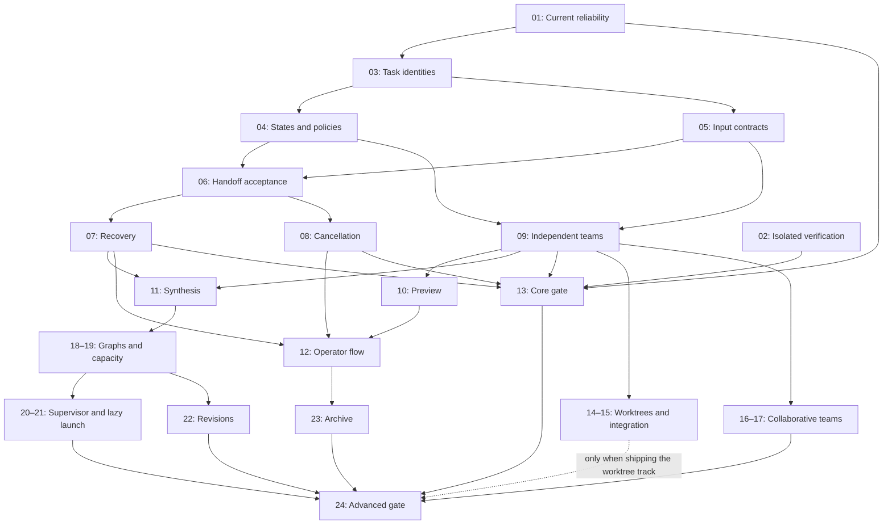

# Bootstrap team and chain roadmap

Implementation plan draft • grilling recommendations accepted • 2026-11-17 • 24 tasks • no source changes

**Confirmed workspace policy:** use the existing project directory by default. Create worktrees only on explicit user request, within the requested scope. Teams, chains, graphs, recovery and revisions must never select worktrees automatically.

**Accepted execution policy:** independent teams by default; parallel disjoint writers and serialized known overlaps; worker-reported outcomes separate from current verification evidence; successful predecessors required by default for new chains; safe delivery repair by the dispatcher, explicit decision before uncertain re-execution. **No prototypes.** Normal implementation tests remain in scope.

Start with [the specification](spec.md). Each [task below](#task-index) has a deliverable, blockers, acceptance criteria, verification and constraints. Status is draft: publication and ready-for-agent labels follow review.

**Implementation status (2026-11-17):** first delivery (tickets 01–09 and gate 13) is implemented and merged on branch `integration/bootstrap-orchestration`; tickets 10–12 and 14–24 are not started. See bootstrap/RELEASE-NOTES.md for shipped capabilities and known limitations.

**Superseded (2026-11-18):** [GRAPH-SPEC.md](../../GRAPH-SPEC.md) replaces tickets 18 and 22, and its parked state replaces ticket 17's lease for loop-body agents only (collaboration leases remain in 17). Tickets 19–21 are unaffected.

## Delivery sequence

| Milestone | Tickets | Result |
| --- | --- | --- |
| Foundation | 01–02 | Verify the current fixes and isolate host tests |
| Hardened core | 03–09, then 13 | Repeat personas, verified outcomes, safe handoffs/recovery and shared-directory ownership |
| Follow-on usability | 10–12 | Richer preview, optional synthesis and expanded /boot commands |
| Optional isolated implementation | 14–15 | Explicitly requested worktrees and integration only |
| Collaborative teams | 16–17 | Typed peer questions and bounded availability |
| Graph execution | 18–19 | Branches/joins and active-task concurrency |
| Unattended/lazy launch | 20–21 | Explicit supervisor and on-demand workers |
| Bounded iteration | 22 | Review/revision attempts with a finite limit |
| Retention and advanced acceptance | 23–24 | Safe archive and combined workflow validation |

The accepted first delivery is **01–09 plus release gate 13**. Tasks 10–12 are follow-on improvements, not release blockers. Workspaces, collaboration and graph execution are optional tracks, not requirements for the core. They may be developed after their declared blockers pass; the table is a roadmap, not a requirement to execute every numbered task serially.

## Task index

| ID | Task | Track | Blocked by |
| --- | --- | --- | --- |
| 01 | [Validate the current reliability changes](issues/01-validate-the-current-reliability-changes.md) | Foundation | None |
| 02 | [Make the host verification harness isolated and reproducible](issues/02-make-the-host-verification-harness-isolated-and-reproducible.md) | Foundation | None |
| 03 | [Allow multiple tasks to use the same persona](issues/03-allow-multiple-tasks-to-use-the-same-persona.md) | Core | 01 |
| 04 | [Expose execution outcomes and dependency policies](issues/04-expose-execution-outcomes-and-dependency-policies.md) | Core | 03 |
| 05 | [Provide bounded shared briefs and explicit input contracts](issues/05-provide-bounded-shared-briefs-and-explicit-input-contracts.md) | Core | 03 |
| 06 | [Distinguish handoff delivery from task acceptance](issues/06-distinguish-handoff-delivery-from-task-acceptance.md) | Core | 04, 05 |
| 07 | [Recover interrupted handoff delivery without rerunning work](issues/07-recover-interrupted-handoff-delivery-without-rerunning-work.md) | Core | 06 |
| 08 | [Cancel runs and enforce configurable deadlines](issues/08-cancel-runs-and-enforce-configurable-deadlines.md) | Core | 04, 06 |
| 09 | [Make independent team execution and ownership explicit](issues/09-make-independent-team-execution-and-ownership-explicit.md) | Core | 04, 05 |
| 10 | [Preview the exact executable plan](issues/10-preview-the-exact-executable-plan.md) | Follow-on usability | 03, 04, 05, 09 |
| 11 | [Add an optional team synthesis stage](issues/11-add-an-optional-team-synthesis-stage.md) | Follow-on usability | 04, 05, 07, 09 |
| 12 | [Make inspection, reporting and recovery usable from /boot](issues/12-make-inspection-reporting-and-recovery-usable-from-boot.md) | Follow-on usability | 04, 07, 08, 10 |
| 13 | [Release and document the hardened team/chain core](issues/13-release-and-document-the-hardened-team-chain-core.md) | Core gate | 01, 02, 03, 04, 05, 06, 07, 08, 09 |
| 14 | [Run implementation members in isolated worktrees](issues/14-run-implementation-members-in-isolated-worktrees.md) | Workspace | 03, 09, 10 |
| 15 | [Integrate isolated outputs with explicit conflict handling](issues/15-integrate-isolated-outputs-with-explicit-conflict-handling.md) | Workspace | 04, 05, 14 |
| 16 | [Support bounded peer questions in collaborative teams](issues/16-support-bounded-peer-questions-in-collaborative-teams.md) | Collaboration | 05, 06, 09 |
| 17 | [Keep completed collaborators available under a bounded lease](issues/17-keep-completed-collaborators-available-under-a-bounded-lease.md) | Collaboration (loop-body parking superseded by GRAPH-SPEC.md) | 08, 16 |
| 18 | [Execute explicit dependency graphs using existing workers](issues/18-execute-explicit-dependency-graphs-using-existing-workers.md) | Graph (superseded by GRAPH-SPEC.md) | 03, 04, 05, 06, 07, 11 |
| 19 | [Limit active task concurrency with durable admission slots](issues/19-limit-active-task-concurrency-with-durable-admission-slots.md) | Graph | 08, 18 |
| 20 | [Add an explicit runtime owner for unattended scheduling](issues/20-add-an-explicit-runtime-owner-for-unattended-scheduling.md) | Graph | 07, 08, 18, 19 |
| 21 | [Launch graph workers only when dependencies are ready](issues/21-launch-graph-workers-only-when-dependencies-are-ready.md) | Graph | 10, 20 |
| 22 | [Support bounded review-and-revision attempts](issues/22-support-bounded-review-and-revision-attempts.md) | Graph (superseded by GRAPH-SPEC.md) | 05, 07, 18 |
| 23 | [Retain and archive run evidence safely](issues/23-retain-and-archive-run-evidence-safely.md) | Operations | 03, 07, 08, 12 |
| 24 | [Validate advanced workflows and publish the operating guide](issues/24-validate-advanced-workflows-and-publish-the-operating-guide.md) | Advanced gate | 02, 13, 17, 19, 21, 22, 23 |

## Dependency overview

The individual task files are authoritative for exact blockers; this diagram groups related work. Tasks 14–15 are optional. Task 22 works in shared cwd without them, and task 24 requires ticket 15 only when validating the optional worktree/integration track.

## Working rules

- Reinspect the relevant code before starting: other work is modifying this workspace.
- Preserve existing work. A ticket marked “validate/complete” is not authorization to replace an implementation wholesale.
- Land a narrow end-to-end behavior, including tool text, durable state, tests and documentation.
- Use current test seams before introducing new abstractions.
- Keep old run inspection and cleanup working throughout migration.
- Do not enable optional capabilities until their contract tests pass.
- Do not infer completion from process idleness, a transport ACK or a heartbeat.
- Do not automatically replay an attempt with uncertain side effects.
- Treat failed infrastructure checks as unverified coverage, not passing tests.
- Do not build prototypes, exploratory spikes or demo branches. Validate production behavior through normal implementation tests.
- Keep model-reported success separate from check evidence, and mark verification stale after relevant repository changes.

## Baseline observed while planning

Already present or being edited: per-agent status and bounded waiting, report digests, stable agent selection for cleanup, plan preview, canonical fingerprints, exclusive reservation publication, cross-process locks, interrupted-launch reconciliation, shared task/roster and session detachment changes. Ticket 01 verifies the current behavior instead of assuming earlier findings are still open.

Observed at 2026-11-17T15:45:19Z; hashes identify the read baseline, not a frozen checkout:

| File | SHA-256 |
| --- | --- |
| bootstrap.ts | 57b7433dd77f925946fa99f0925af122be28c415b08d6364298d63f2e3d73857 |
| bootstrap/lifecycle.ts | d6aa7d683fae79922d6b05f1ab53cd114eebae3d51f4ac72bc6e7e0b400705fa |
| bootstrap/worker.ts | 2300f6a9eda96cc6bc547ba20589832a486c82548008f82bcdcf7375aa266dd5 |
| bootstrap/session-store.ts | d39fe53a47416d83eb3a453ffaef8f8b5f2341dd6c5d362e4ab3819b5a5f3c11 |

Earlier direct runs passed 62 existing tests at that earlier baseline; one launcher test was blocked by spawnSync EPERM and two runtime smoke tests by a read-only trust directory. These are historical findings, not verification of today's changing code or the proposed implementation.

## Review and publication

The user accepted all six grilling recommendations and declined prototypes. Task granularity remains one independently demonstrable behavior per task; this decision update does not start implementation or publish issues. In particular, supervisor lifecycle and isolated integration have the highest implementation risk.

No external issue tracker is configured in the inspected workspace. Run /engineering setup-matt-pocock-skills if external issue publication is wanted. Until then, these files are the reviewable plan.
